# Strike Guardian — RiskOS

**A pre-trade assistant for a market where visible liquidity can be smaller than the trade you want to place.**

[中文说明](README.zh-CN.md) · [Integration & configuration](docs/INTEGRATION.md) · [API verification](API-VERIFICATION.md) · [90-second demo](DEMO.md)

## The problem we solve

A displayed price is not the price at which an entire order will necessarily execute. When order-book depth is limited, opening a leveraged position can consume multiple price levels, increase slippage, and leave part of the order unsupported by visible liquidity. Exiting can be harder, especially during a sudden move. A stop-loss trigger does not guarantee an execution price.

Strike Guardian checks a proposed trade **before submission**, using Strike Finance's live order book, market rules and, after authorization, account data. It helps answer:

- Can the currently visible book support this position, and at what estimated average / worst price?
- What would an immediate reverse exit cost against the current book?
- How do leverage, stop distance, fees and holding-period funding affect modeled risk?
- What happens if price suddenly moves 5%, 10% or 20%?
- Is the account's effective margin mode compatible with the plan, and should the position be smaller?

**Current release: read-only assessment. It does not submit trades, move funds or change account settings.** It is a standalone application plus an integration adapter; it is not yet embedded in or officially endorsed by Strike.

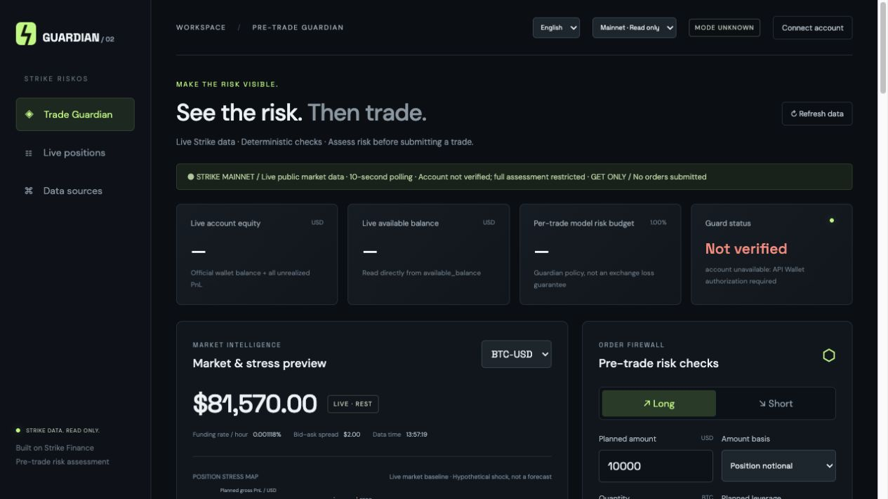

## What has actually been verified?

Verification date: **23 October 2026**. Screenshots below are actual browser captures of this version using live public mainnet data. Prices and visible depth change continuously; screenshots are observations, not promised future fills.

| Area | Evidence | Status |
|---|---|---|
| Syntax / modules | `npm run check` | Passed |
| Deterministic engine, signatures, read-only gateway, localization | `npm test` | **57 / 57 passed** |
| Public Strike APIs | `npm run test:public` | **6 / 6 verified live** |
| Browser workflow | Screenshots and [record](docs/verification/browser-checks.json) | Live public-data flows exercised |
| Real private account | Requires the user's registered API Wallet | **Not yet verified end to end** |
| Trading execution | No write routes in this release | Not implemented |

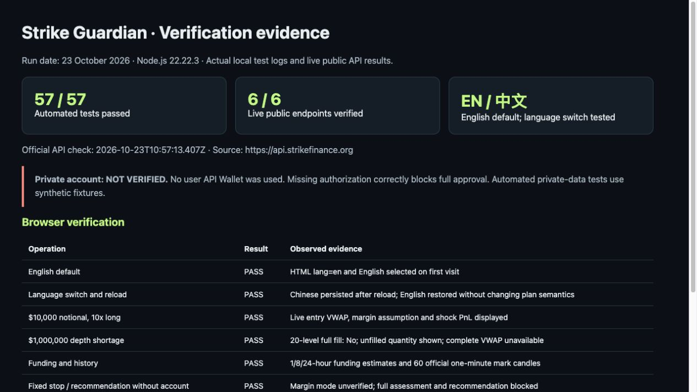

This image is a browser screenshot of a report rendered from saved test output, not a terminal screenshot. Inspect the evidence directly: [test log](docs/verification/tests.txt), [syntax log](docs/verification/check.txt), [live API output](docs/verification/public-api.txt), [report HTML](docs/verification/report.html). Private-data tests use synthetic fixtures exclusively under `tests/`; they do not prove that a user's live account has been authorized.

## Run locally

Requires **Node.js 22+**. No third-party runtime dependencies; no `npm install` step is needed.

```sh
git clone https://github.com/longzexd/strike-guardian.git
cd strike-guardian
npm start
```

Open **http://127.0.0.1:4173**. If that port is occupied, use `PORT=4183 npm start` and open the corresponding port. The screenshots were taken using an independent local port.

### 1. Choose a language

The first visit defaults to **English**, regardless of browser language. Use the header selector to switch to **中文**. The choice is remembered in `guardian.language`; only the language preference is stored. Switching language changes labels, warnings, dynamic results and accessible descriptions, without changing quantities, API payloads or risk decisions.

**Tested:** English on first visit; switching to Chinese; Chinese retained after reload; switching back to English. Chinese view below uses the same live-data application.

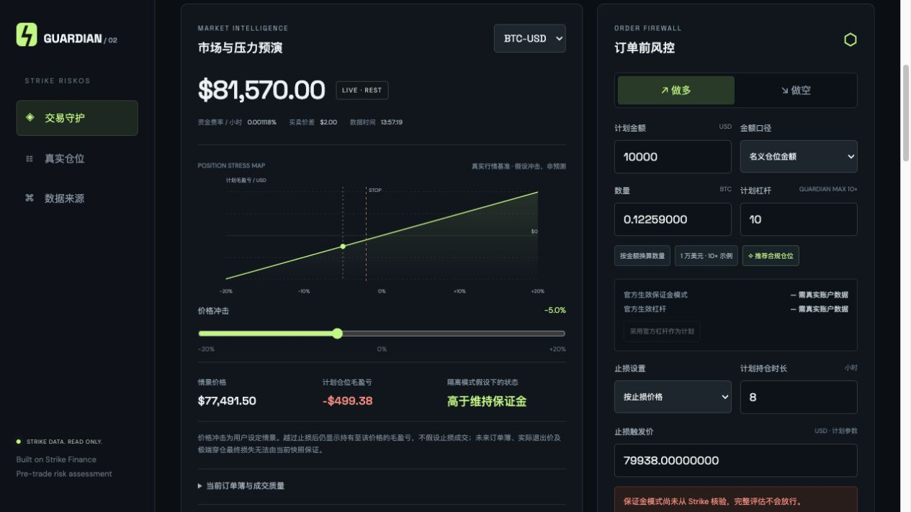

### 2. Assess a $10,000 notional, 10× long

1. Leave the network on **Mainnet · Read only** and select **BTC-USD**.
2. Wait for **LIVE · REST** and the public-data connection banner.
3. Click **$10,000 · 10× example**. It sets a $10,000 **notional**, 10× planned leverage and an example stop about 2% below the current mark, aligned to the official tick grid.
4. Inspect the quantity, entry estimate and stress graph. The example is a user plan, not an actual order or recommendation.

**Tested:** quantity was converted using live mark and the official size grid; the public preview displayed entry VWAP and approximately $1,000 of initial margin under the planned leverage assumption. Full approval remained blocked without account authorization.

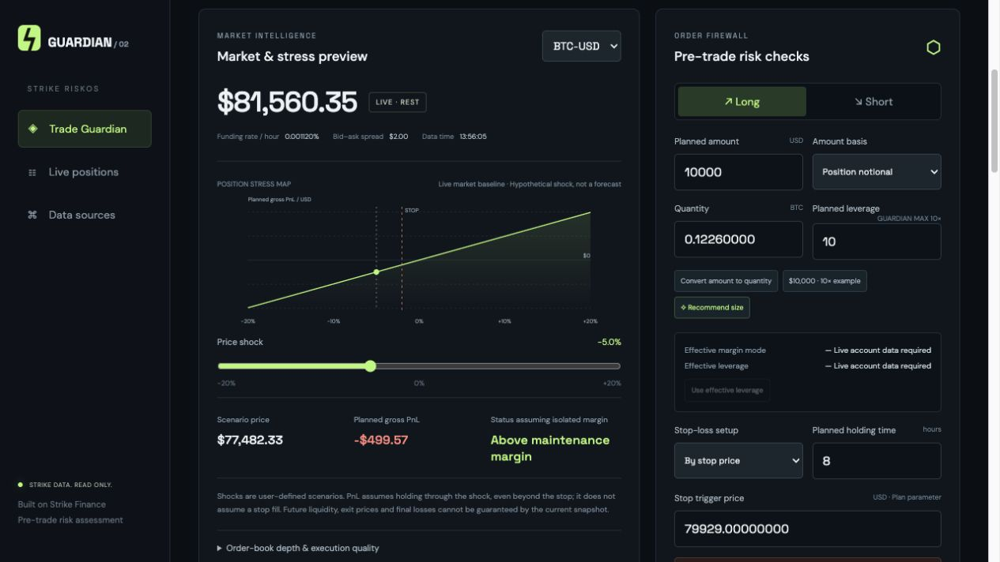

**Amount basis matters:** $10,000 of **Position notional** at 10× implies approximately $1,000 of margin. $10,000 of **Planned margin** implies approximately $100,000 of notional. Actual fund reserves additionally depend on verified account data and fees. The amount-basis distinction is covered by automated tests.

### 3. Inspect opening and exit liquidity

Expand **Order-book depth & execution quality**. Guardian walks asks for a long entry or bids for a short entry, calculating quantity-weighted average price and the worst consumed level. It also estimates the opposite-side immediate exit against the same current snapshot.

**Tested:** the $10,000 plan fitted inside the returned book; full-entry status, worst entry, reverse-exit VWAP and round-trip spread PnL were populated. Account fees remained explicitly unavailable.

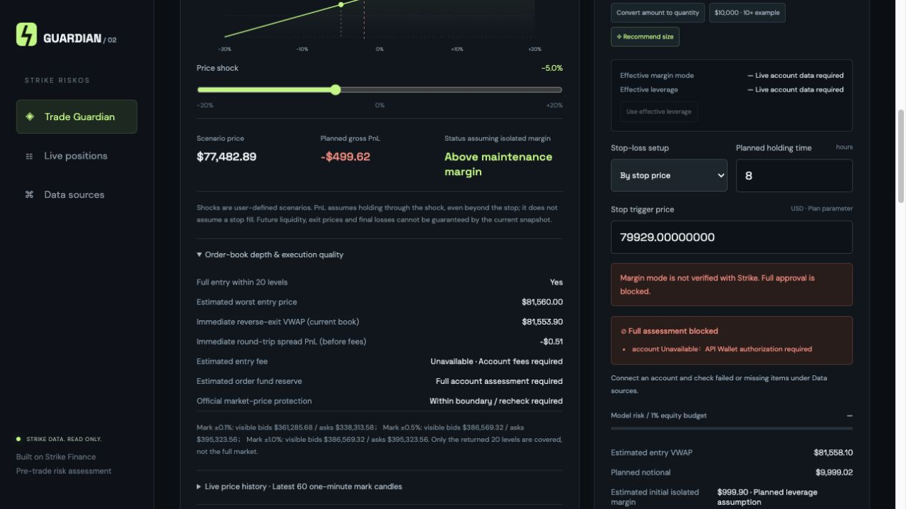

Depth bands show visible bid / ask notional around mark. **Only the returned 20 levels per side are covered.** A successful current-book estimate cannot guarantee future liquidity, stop execution or actual fills. Round-trip spread PnL excludes trading fees and funding.

### 4. Detect a plan larger than visible depth

Change **Planned amount** to `1000000`, keep **Position notional**, then click **Convert amount to quantity** and inspect the expanded order-book panel.

**Tested:** the live snapshot could not cover this plan. The panel displayed **No · Unfilled …**, and omitted the complete entry / exit estimates rather than inventing liquidity. The unfilled amount changes with the live book. This does not prove that the entire exchange lacks liquidity beyond the returned levels.

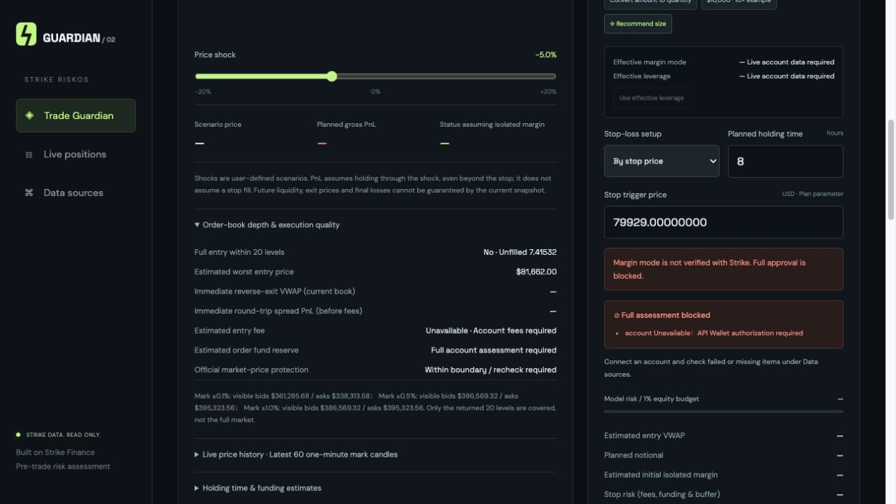

### 5. Compare holding-period funding

Restore **$10,000 · 10× example** and expand **Holding time & funding estimates**. Compare 1, 8 and 24 hours, or enter your own holding time.

**Tested:** settlement counts and funding cash flows changed with the holding horizon. For this approximately $10,000 long, the screenshot shows roughly $0.11 / $0.89 / $2.68 of funding costs at 1 / 8 / 24 hours. These are estimates at the captured rate, not fixed charges. Personal trading fees were left unavailable.

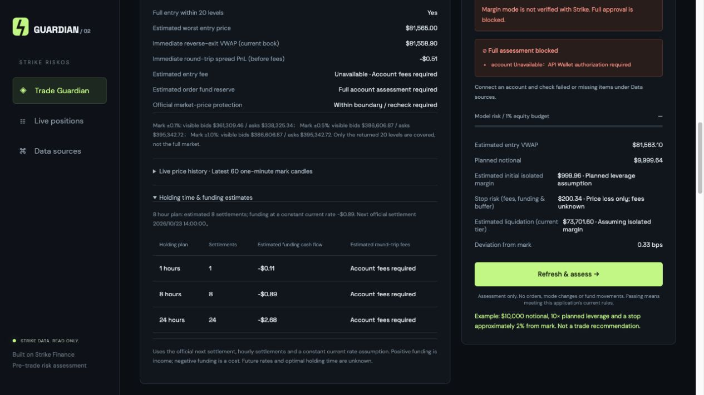

Uses the official next settlement time and hourly settlement boundaries, assuming the current rate remains constant. Positive funding means income; negative means cost. Guardian does not predict the optimal holding time or future funding rates.

### 6. Examine sudden price moves

Use the **Price shock** slider, then review **What happens in a sudden price move?** for −20%, −10%, −5%, +5%, +10% and +20% scenarios.

**Tested:** a roughly $10,000 long showed about $500 of gross loss at −5% and about $1,000 at −10%; the deeper negative scenarios flagged the modeled liquidation condition. Results after fees remained unavailable without the account fee tier.

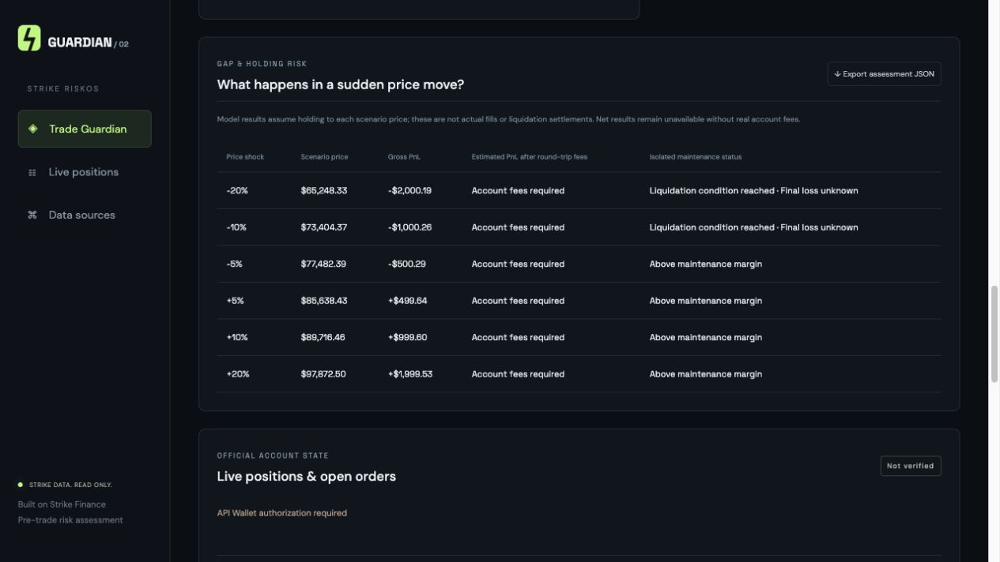

The model assumes the position is held through the shock, even beyond the proposed stop. It does **not** assume that a stop has filled. Beyond a liquidation threshold, displayed gross PnL is hypothetical; final liquidation loss is unknown. Isolated mode and a fixed-dollar budget do not turn a stop into a guaranteed fill or guaranteed loss cap.

### 7. Require verified isolated margin for a fixed-dollar stop

Select **Fixed-dollar stop budget** and enter a budget, such as `100`. The effective mode must come from Strike's `/v2/symbols`, not a user-selected assertion.

**Tested live without credentials:** unknown mode displayed **Margin mode is not verified with Strike. Full approval is blocked.**

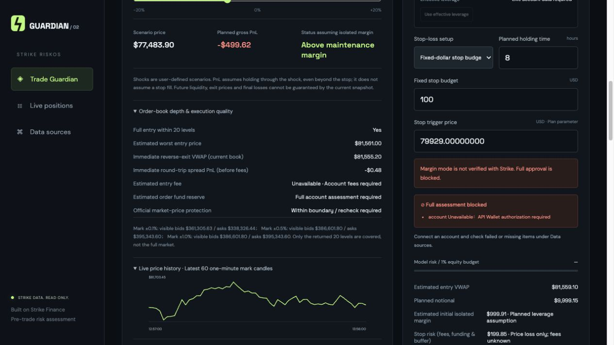

**Automated contract coverage:** official cross mode, unknown mode and missing effective settings block approval; claiming isolated mode in the draft cannot override official cross mode. These cases are synthetic tests, not screenshots of a live cross-margin account. Change the mode in Strike itself, then refresh; Guardian never changes it for you. This MVP currently restricts all new-position approval to isolated margin.

### 8. Request a smaller position

Click **Recommend size** after setting the direction, stop and holding time. With complete, fresh account data, the engine searches the official quantity grid for a smaller admissible position and leaves 5% model-risk budget headroom. The candidate must pass the same checks as the original plan, including funding recalculated for its quantity.

**Tested live without credentials:** the application refused to invent a position recommendation and displayed the missing account authorization. Positive recommendations and budget compliance are covered by synthetic automated tests; live authorized-account recommendation remains to be verified.

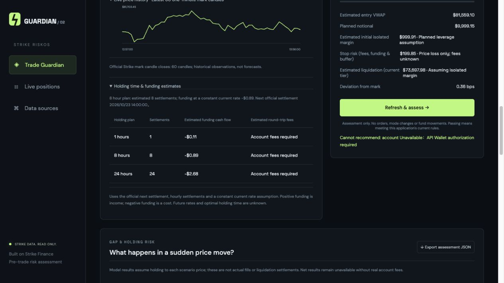

### 9. Connect your registered API Wallet

Click **Connect account**. Recommended local setup:

```sh
cp .env.example .env
# Edit .env on your own computer; never paste keys in chat or commit them.
npm run start:env
```

Configure `STRIKE_NETWORK`, `STRIKE_API_PUBLIC_KEY` and `STRIKE_API_PRIVATE_KEY`, then click **Connect locally configured API Wallet**. Use an API Wallet Ed25519 seed, never a funding-wallet recovery phrase. Supported private export: 64 hex characters for the 32-byte seed, or 128 for seed+public; the key pair must match. Network must match the registered wallet.

**Tested:** the connection panel and missing-configuration state display correctly, without fabricated account values. **A real private-account success screenshot is not available because no user's API Wallet was connected.**

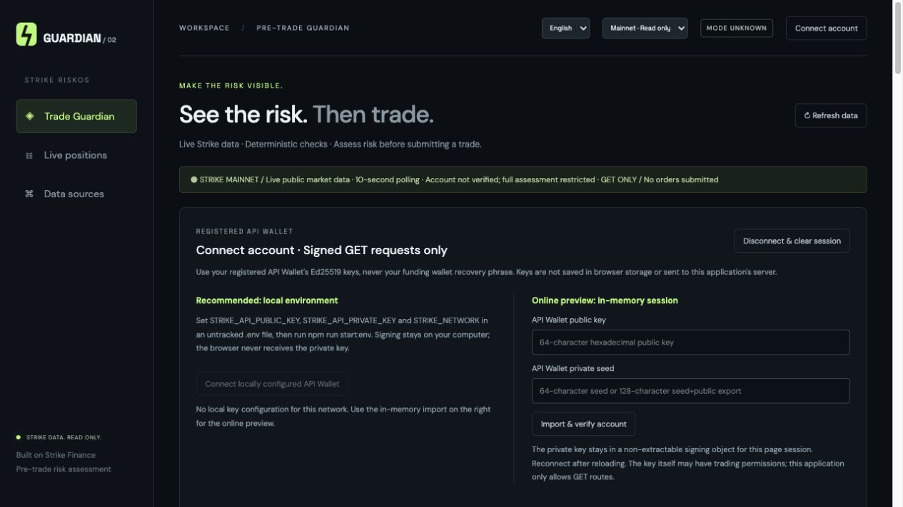

Local signing keeps the private key out of the browser. The optional in-page import uses a non-extractable WebCrypto signing key in memory, clears the inputs and requires supported Ed25519 / CORS behavior. Keys are not persisted. A registered API Wallet may itself have trading permissions, but this application's signer and gateway allow only approved GET routes.

After connecting, verify account, symbols, positions, open orders and portfolio under **Data sources**. Planned leverage must match effective leverage; same-market existing positions / pending orders are unsupported in this MVP and block approval. See [full configuration and integration notes](docs/INTEGRATION.md).

### 10. Inspect provenance and export an assessment

Open **Data sources** to see each endpoint's status and last read time. Click **View** to inspect its official response. Then click **Export assessment JSON**. The downloaded JSON and in-page **Export preview** use the same serialized data.

**Tested:** all six public sources were loaded; seven private sources explicitly required authorization. The export contained `mode: READ_ONLY_REAL_DATA`, `uiLanguage: en`, `accountId: null`, `assessment.ok: false` and a valid public-market analysis. No private account or secret was included in the published evidence.


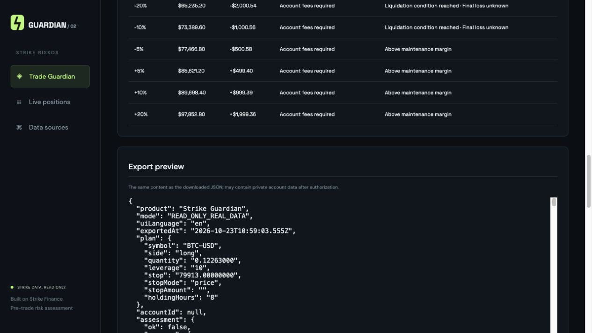

Inspect the [captured public-only export](docs/verification/public-assessment.json). **Exports made after authorization can contain private account data; review them before sharing.** Machine-readable plans, raw official payloads and decision reasons are kept in their source form rather than translated.

### 11. Inspect real historical prices

Expand **Live price history · Latest 60 one-minute mark candles**. This uses Strike mark-price candle closes, not generated candles.

**Tested:** the chart displayed 60 official one-minute observations, with its source note. Historical prices provide context, not forecasts.

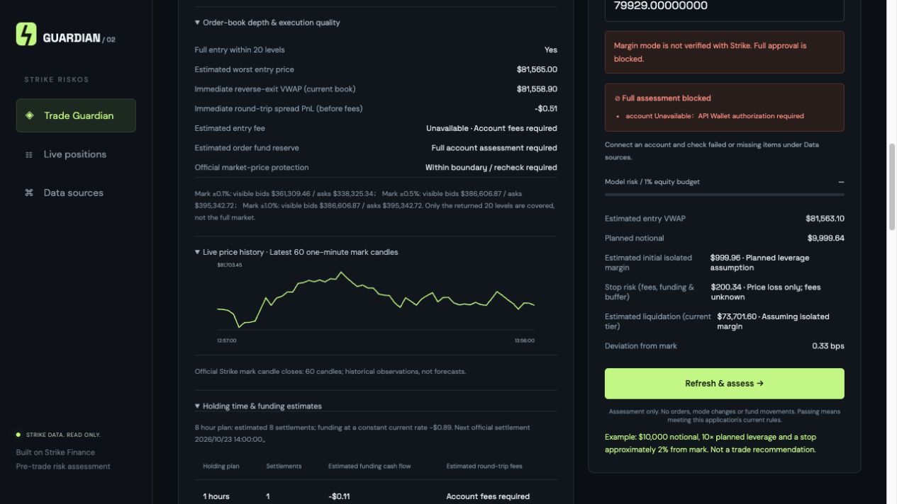

## Data sources and calculation boundaries

Official mainnet origin: `https://api.strikefinance.org`. Testnet read origin: `https://api-v2-testnet.strikefinance.org`.

| Official GET route | Use | Access |
|---|---|---|
| `/v2/time` | Official clock and signing time | Public |
| `/v2/markets` | Status, grids, margin tiers, price protection | Public |
| `/price/v2/markPrice?symbol=…` | Mark, funding rate, next settlement | Public |
| `/price/v2/depth?symbol=…&limit=20` | Entry / reverse exit / visible depth | Public |
| `/price/v2/klines?symbol=…&interval=1m&limit=60&priceType=mark` | Historical mark-price context | Public |
| `/v2/fee-tiers` | Public fee tiers, not a substitute for personal fees | Public |
| `/v2/account` | Balances, equity components, account ID | API Wallet |
| `/v2/symbols` | Effective per-market mode and leverage | API Wallet |
| `/v2/positions` | Existing exposure and official liquidation reference | API Wallet |
| `/v2/openOrders` | Pending exposure / conflicts | API Wallet |
| `/v2/portfolio` | Personal fee tier, discounts, trading status | API Wallet |
| `/v2/history/order?limit=20` | Recent order context | API Wallet |
| `/v2/history/fill?limit=20` | Recent fill context | API Wallet |

- **Official facts:** source responses. Missing facts stay missing; no fake balances or default personal fees.
- **Derived estimates:** VWAP, initial margin, effective discounted fees, isolated liquidation reference for a new plan, funding and shock outcomes.
- **Guardian policy:** 1% equity stop-model budget; 25% total margin allocation; 10× leverage cap; 20 bps entry-VWAP deviation cap; 10 bps extra risk buffer; stop clearance of 0.5% of mark from estimated liquidation; at most 3 independent positions. These are application policies, not Strike guarantees.
- **Unknown:** future liquidity, funding, prices, stop fills, final liquidation settlement and optimal holding time.

Approval uses BigInt fixed-point arithmetic at 8 decimals and conservative cent rounding. Stop-model risk includes price loss, estimated round-trip taker fees, an extra buffer and projected funding cost; projected funding income does not offset the risk budget. Quantities follow the official grid. UI graphs use floating-point display calculations.

REST polling runs every 10 seconds; critical current account / market packets expire after 15 seconds. Multiple responses do not form an atomic account transaction. Historical and candle failures are disclosed without invented replacements. The API Wallet's bound default account is the scope; there is no cross-subaccount selector. Each history endpoint returns one page of at most 20 records.

## Integrate into Strike

`dist/guardian-adapter.mjs` exports `createStrikeRiskGate`. A host supplies its existing authenticated GET reader, calls `gate.evaluate(plan)`, displays the report and stops its own submission path when `report.decision.ok` is false. See the [integration example](docs/INTEGRATION.md#集成到-strike-主应用).

The standalone page cannot prevent orders submitted elsewhere. A mandatory gate must be rechecked in Strike's trusted backend / order engine immediately before execution. Browser-editable checks are not a security boundary. No official integration or approval is claimed.

## Reproduce verification

```sh
npm run check
npm test
npm run test:public
```

`npm test` is deterministic and does not require a wallet or network. `test:public` requires outbound access to Strike; a network or service failure should fail visibly, not substitute saved data. The committed captures are dated evidence and are never fed back into the production UI.

Key files: `dist/risk.mjs` (fixed-point engine), `dist/market-analysis.mjs` (book / funding / shocks), `dist/admission.mjs` (live-data admission), `dist/strike-client.mjs` (collector), `dist/i18n.mjs` (presentation localization), `server.mjs` (loopback read-only gateway).

[Official builder reference](https://github.com/strike-finance/strike-builder-reference) · [API verification details](API-VERIFICATION.md) · [MIT license](LICENSE)
